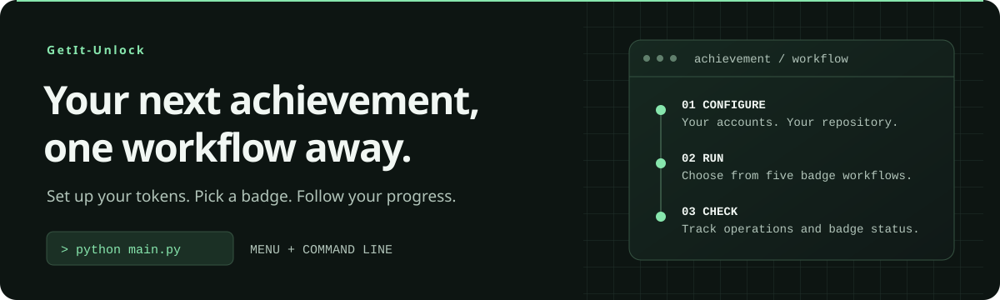

<p align="center">
  
</p>

# GetIt-Unlock

Run and verify six GitHub achievement workflows from a terminal menu or a command. The CLI uses an ASCII banner, colored brackets, and numbered menus inspired by Zphisher across Linux, Windows, and Termux. Startup explains missing configuration, guided setup connects your accounts, and previews show each workflow before execution.

Developed by **[Antech-greyhat](https://github.com/Antech-greyhat)**. For educational purposes; users are responsible for their actions and the developer is not responsible for abuse or misuse. Read the [educational-use notice](DISCLAIMER.md). The code retains its [MIT license](LICENSE).

<p align="center">
  
</p>

<p align="center">
  <a href="#pull-shark"></a>
  <a href="#pair-extraordinaire"></a>
  <a href="#quickdraw"></a>
  <a href="#yolo"></a>
  <a href="#galaxy-brain"></a>
  <a href="#starstruck"></a>
</p>

**Badge guides:** [Pull Shark](#pull-shark) · [Pair Extraordinaire](#pair-extraordinaire) · [Quickdraw](#quickdraw) · [YOLO](#yolo) · [Galaxy Brain](#galaxy-brain) · [Starstruck](#starstruck)

> [!TIP]
> **Choose [how to run on your operating system](#run-on-your-operating-system), then follow the numbered steps.** If you have not downloaded the app, use [Get the app](#get-the-app) first. Install Python 3.11+ and the packages in `requirements.txt` once. Launch with Bash on Linux/Termux or PowerShell on Windows; both use the same Python CLI.

## Find your next step

| Step | What you will do |
| :--- | :--- |
| **01 · [Set up tokens](#1-put-your-tokens-in-env)** | Configure your primary account, target repository, and optional helper. |
| **02 · [Check the connection](#2-check-the-repository-and-connection)** | Confirm the repository is ready and run `doctor`. |
| **03 · [Try Pull Shark](#3-run-your-first-pr-test)** | Choose a level and run from a command or the menu. |
| **04 · [Choose another badge](#4-run-another-badge)** | Check its level table, complete its prerequisites, and run. |
| **05 · [Check progress](#5-check-progress-and-badges)** | See completed operations and check your public badges. |
| **06 · [Clean up](#6-clean-up-leftover-branches)** | Preview and remove verified merged branches. |

[Run on your OS](#run-on-your-operating-system) · [Common fixes](#common-fixes) · [Rate limits](#rate-limits-let-the-app-wait) · [Advanced options](docs/advanced.md) · [Get the app](#get-the-app)

---

## Run on your operating system

Run commands inside the downloaded project folder. Bash, PowerShell, and Python share the same commands, interactive menu, `.env` settings, and saved progress. The launchers select a compatible project `.venv` automatically and avoid Python bytecode caches.

| Operating system | Default launcher | Optional launcher |
| --- | --- | --- |
| Windows | `.\main.ps1` in PowerShell | `.venv\Scripts\python main.py`; `bash main.sh` in Git Bash or WSL |
| Linux | `bash main.sh` | `.venv/bin/python main.py` |
| Android / Termux | `bash main.sh` | `python main.py` |
| macOS | `bash main.sh` | `.venv/bin/python main.py` |

The badge examples below use `python main.py`. Replace that prefix with `.\main.ps1` on Windows or `bash main.sh` on Linux/Termux, keeping every argument. For direct Python, use the interpreter where you installed the requirements, such as `.venv\Scripts\python` or `.venv/bin/python`.

### Windows: PowerShell

Install [Python 3.11 or newer](https://www.python.org/downloads/windows/) and enable **Add Python to PATH** in the installer. Open PowerShell in the project folder and install the terminal libraries:

```powershell
python --version
python -m venv .venv
.venv\Scripts\python -m pip install --no-cache-dir -r requirements.txt
.\main.ps1 --help
```

Start the dashboard. If `.env`, the primary token, or the target repository is missing, startup outlines what is needed and offers guided setup:

```powershell
.\main.ps1
.\main.ps1 doctor
```

If Windows provides `py` instead of `python`, create the environment with `py -3 -m venv .venv`. PowerShell 5.1 and PowerShell 7 are supported. If your execution policy prevents running `.ps1` scripts, run `.venv\Scripts\python main.py` with the same arguments. No virtual-environment activation is needed.

**Optional Bash:** install [Git for Windows](https://git-scm.com/downloads/win), open **Git Bash** in the project folder, and use your Windows Python installation:

```bash
bash main.sh --help
bash main.sh doctor
bash main.sh
```

You can also use [WSL](https://learn.microsoft.com/windows/wsl/install). Inside your WSL distribution, install Bash and Linux Python 3.11+ and follow the Linux steps below.

### Linux: Bash by default

The launcher works across Linux distributions with **Bash and Python 3.11+** installed. It does not depend on a particular package manager. Git is needed only if you clone the app rather than download its ZIP.

Use your distribution's package manager to install the tools:

| Distribution family | Install command |
| --- | --- |
| Debian, Ubuntu, Mint, Kali | `sudo apt update` then `sudo apt install bash python3 git` |
| Fedora, RHEL, Rocky, AlmaLinux | `sudo dnf install bash python3 git` |
| Arch, Manjaro | `sudo pacman -Syu bash python git` |
| openSUSE | `sudo zypper install bash python311 git` |
| Alpine | `sudo apk add bash python3 git` |
| Void | `sudo xbps-install -S bash python3 git` |

On other distributions, install the equivalent Bash and Python packages. Run `python3 --version` (or `python3.11 --version` for openSUSE) to check the version. Older distribution releases may need a newer Python package; keep the system Python and use a separate 3.11+ installation to create `.venv`. If you are already root, omit `sudo`.

From the project folder, install the libraries into a virtual environment and check the launcher. Some distributions package `venv`/`pip` separately; Debian/Ubuntu users can install `python3-venv` with their package manager if needed:

```bash
python3 -m venv .venv
.venv/bin/python -m pip install --no-cache-dir -r requirements.txt
bash main.sh --help
```

On openSUSE, if the compatible interpreter is named `python3.11`, replace the first command with `python3.11 -m venv .venv`. The launcher then selects `.venv/bin/python` automatically. No virtual-environment activation is needed.

Start the menu and follow guided setup, or [save your tokens in `.env`](#1-put-your-tokens-in-env) before checking the connection:

```bash
bash main.sh
bash main.sh doctor
```

**Optional Python:** use `.venv/bin/python main.py doctor` and `.venv/bin/python main.py`. All workflow arguments work with either launcher. Using `bash main.sh` does not require `chmod` or an executable filesystem. If you selected a versioned Python executable, use it to create `.venv` and install requirements there.

### Android: Termux

Install a current [Termux release](https://termux.dev/en/), then install the tools inside Termux:

```bash
pkg update
pkg install bash python python-pip git
git clone https://github.com/Antech-greyhat/GetIt-Unlock.git
cd GetIt-Unlock
python -m pip install --no-cache-dir -r requirements.txt
bash main.sh --help
```

Keep the project in Termux's home directory. Launch to follow guided setup, or use [Step 1](#1-put-your-tokens-in-env) to create `.env` there:

```bash
bash main.sh
bash main.sh doctor
```

**Optional Python:** use `python main.py doctor` and `python main.py` in the same folder.

### macOS

Install Python 3.11+ from [python.org](https://www.python.org/downloads/macos/) or your package manager. Create `.venv` and install `requirements.txt` using the Linux commands above. Use the built-in Bash to run `bash main.sh`, or run `.venv/bin/python main.py` directly.

### How the launchers find Python

`main.sh` and `main.ps1` try a compatible project `.venv` first, then `python3`, `python`, and the Windows `py -3` launcher. PowerShell prefers `.venv/Scripts/python.exe`; Bash prefers `.venv/bin/python`. They skip interpreters older than 3.11 and report installation guidance if none are suitable. If Python packages are missing, startup prints the install command for the selected interpreter.

To select a particular interpreter, set one executable name or path in your Bash shell:

```bash
export GETIT_UNLOCK_PYTHON="/path/to/python3.11"
bash main.sh --help
```

In PowerShell, use `$env:GETIT_UNLOCK_PYTHON = 'C:\path\to\python.exe'`. For Git Bash, a Windows path can be written as `/c/Users/YourName/path/to/python.exe`. This override takes precedence over `.venv`; install `requirements.txt` into the interpreter you select. To restore automatic selection, run `unset GETIT_UNLOCK_PYTHON` in Bash or `Remove-Item Env:GETIT_UNLOCK_PYTHON` in PowerShell. Set this variable in the shell, rather than in `.env`. All launchers read `.env` and save `.achievement-state` in the current working directory; use `--env-file` and `--state-dir` to choose other paths.

### Startup, menus, and exit

Startup checks local requirements one at a time on a separate loading screen. The whole sequence takes about three seconds, then clears and opens the main menu with the banner and educational-use notice. Missing credentials or an invalid repository setting appear in a short warning above the input prompt; you can browse and preview immediately, then use **05 · Connect or create a repository** to configure the tool later. The warning refreshes when you return to the menu. Local checks do not connect to GitHub. Helpers are requested when a selected workflow needs one.

Type an option number such as **01** or **1**, then press **Enter**. An empty **Enter** selects the displayed default. **00**, **0**, or **q** goes back, and exits from the main menu. **Ctrl+C** exits the complete session; an EOF also exits (Linux/Termux: **Ctrl+D**; Windows: **Ctrl+Z**, then **Enter**). Tokens use hidden input. Wide terminals arrange menus in columns; narrow terminals stack choices and use a compact banner.

Blue titles and numbers identify menus; choices use your terminal's normal text color, with the default choice in bold. Purple **[?]** prompts show where to type, amber **[!]** messages flag settings that need attention, and red messages indicate errors. The banner uses teal, while the disclaimer and other background information use quieter text. Menu titles use larger lettering when it fits, with a regular heading on narrow or short screens or in plain output. Short screens also reduce extra spacing. The actual typeface and text size follow your terminal settings. Labels and symbols keep the interface understandable without color.

Use `bash main.sh --plain` (Windows: `.\main.ps1 --plain`) to disable colors, screen clearing, and animations. Add `--no-animation` to keep static loading messages while retaining colors. Both options skip startup delays; plain output retains the check results for scrollback. `NO_COLOR` disables color. Redirected output is static, and `--json` commands retain clean JSON. Developer, star, and fork URLs remain visible on all terminals; terminals that support hyperlinks can also make them clickable.

The exit screen shows your developer profile and clickable **Star**/**Fork** URLs, followed by **Thanks for using this tool, dont forget to star and fork**. Links open in terminals that support hyperlinks; the complete URLs can also be copied. No browser opens automatically and no stars/forks are submitted automatically.

For local setup guidance at any time, run `bash main.sh requirements` (Windows: `.\main.ps1 requirements`). In the dashboard, **Requirements and advanced tools** also contains the history-reset preview. **Check connection** lets you select a workflow so helper access and repository features are checked before running.

---

## 1. Put your tokens in `.env`

Open the project folder. Create **`.env`** next to `main.py`, using [.env.example](.env.example) as a reference, or edit your existing file:

```dotenv
GITHUB_TOKEN=PASTE_YOUR_PRIMARY_TOKEN_HERE
TARGET_REPO=your-username/your-repository
HELPER_TOKEN=
```

Replace the placeholders locally after creating your token below. Save the file as **`.env`**, not `.env.txt`.

### Two accounts, one target repository

| Account | Repository relationship | Token goes in |
| --- | --- | --- |
| Primary account | Owns the personal repository that receives the activity | `GITHUB_TOKEN` |
| Helper account | A different GitHub username used for the badges listed below | `HELPER_TOKEN` |

Set `TARGET_REPO` to **your primary account's repository**, in `username/repository` format. Both tokens go in the same local `.env`; one copy of the CLI uses the appropriate account for each action. The helper needs no separate repository, fork, or CLI installation.

If you need a target repository, sign in as your primary account, open [Create a repository](https://github.com/new), choose that account as the owner, enter a name, and select **Add a README file**. Put the resulting `owner/name` in `TARGET_REPO`. A public repository supports all six workflows.

### How to create the primary token

An existing, unexpired classic token with **repo** selected can be reused.

1. Sign in to your **primary GitHub account**, which owns the target repository.
2. Open **[Personal access tokens](https://github.com/settings/tokens)**.
3. Click **Generate new token → Generate new token (classic)**.
4. Enter a name, choose an expiration date, and select the **repo** checkbox.
5. Click **Generate token** and copy the value while GitHub displays it.
6. Paste it after `GITHUB_TOKEN=` in `.env`, then save.

The menu path is **Profile picture → Settings → Developer settings → Personal access tokens → Tokens (classic)**. Token creation happens in personal account settings. A classic `repo` token can access repositories its account already has permission to use; it does not ask you to select one repository. For a primary token limited to your target, follow the [fine-grained token steps](docs/advanced.md#use-a-token-limited-to-one-repository).

### How to create the helper token

Create a helper token for **Pair Extraordinaire, YOLO, or Galaxy Brain**, or an optional [Starstruck helper star](#starstruck). It must belong to a different GitHub account.

1. Sign in as the **helper** and check its username under the profile picture.
2. Open its **[personal token settings](https://github.com/settings/tokens)** and choose **Generate new token (classic)**.
3. Enter a name and expiration date, select **repo**, and generate the token. An existing working classic `repo` token can be reused.
4. Paste the helper's token after `HELPER_TOKEN=` in the same `.env`:

```dotenv
GITHUB_TOKEN=TOKEN_FROM_PRIMARY_ACCOUNT
TARGET_REPO=your-username/your-repository
HELPER_TOKEN=TOKEN_FROM_SECOND_ACCOUNT
```

Replace these placeholders locally. Keep the primary token in `GITHUB_TOKEN` and the primary repository in `TARGET_REPO`. For Pull Shark and Quickdraw, leave `HELPER_TOKEN=` empty. If a required helper token is missing, the interactive CLI asks for it with hidden input.

### Which token does each badge need?

The primary classic `repo` token works for all six workflows. The helper classic `repo` token works for the helper actions below.

| Badge | Helper token | Must the helper accept a repository invitation? |
| --- | --- | --- |
| [Pull Shark](#pull-shark) | Not needed | No |
| [Quickdraw](#quickdraw) | Not needed | No |
| [Pair Extraordinaire](#pair-extraordinaire) | Required | No |
| [YOLO](#yolo) | Required | Yes |
| [Galaxy Brain](#galaxy-brain) | Required | Yes |
| [Starstruck](#starstruck) | Optional, to add one star | No |

If the helper is only used for **Pair Extraordinaire** with default co-author settings, a classic token with no scopes selected is sufficient. A custom co-author email needs **user:email** access for verification; see [co-author email options](docs/advanced.md#co-author-email-options).

### Invite the helper for YOLO and Galaxy Brain

Complete this once for the same target repository; YOLO and Galaxy Brain can reuse the invitation and helper token.

1. Sign in as the **repository owner** and open the target repository.
2. Open **Settings → Collaborators**, under **Access**, then click **Add people**.
3. Search for the helper's username, select that account, and send the invitation.
4. Sign in as the **helper**, open the invitation from GitHub's email or notifications, and accept it.
5. As the owner, check **Settings → Collaborators** again. The helper must have access, with no pending invitation.

The accepted invitation grants repository access; the helper's token lets the app use it. Accepting an invitation does not require replacing an already suitable token. Use a **classic `repo` helper token** for these workflows because fine-grained tokens have limitations accessing another personal account's repository. See [GitHub's invitation guide](https://docs.github.com/en/repositories/managing-your-repositorys-settings-and-features/repository-access-and-collaboration/inviting-collaborators-to-a-personal-repository) if needed.

> [!IMPORTANT]
> **Never share or commit `.env`.** The app reads it automatically, so tokens do not need to appear in commands.

---

## 2. Check the repository and connection

For Pull Shark, Pair Extraordinaire, and YOLO, the target must have at least one commit. Add a README if it is empty. Under **Settings → General → Pull Requests**, enable **Allow merge commits**. Branch rules and required checks still apply when merging.

Open a terminal **inside this project folder** and run the connection check for your operating system.

Windows (PowerShell default):

```powershell
.\main.ps1 doctor
```

Linux / Termux (Bash default), or optional Bash on Windows:

```bash
bash main.sh doctor
```

You should see `Connected as your-username to your-username/your-repository`, with your actual account and target. Resolve any error using [Common fixes](#common-fixes) before running a workflow. `doctor` checks access without creating GitHub activity; each badge below also lists any specific setup it needs.

For direct Python, use the interpreter where the requirements are installed: `.venv/bin/python` on Linux or `.venv\Scripts\python` on Windows.

The module launcher is `python -m getit_unlock`; after installing the package, the equivalent command is `getit-unlock`.

---

## 3. Run your first PR test

The level tables show **total qualifying activity**, rather than an additional count for each upgrade. These are [community-reported thresholds](https://github.com/Schweinepriester/github-profile-achievements#tiers), matching the app's targets. GitHub decides whether and when to award a badge.

All `run` commands below perform GitHub actions with `--execute`. Leave that option off to preview the plan and sample messages first.

### Pull Shark

<p>
  
</p>

**Goal:** get your pull requests (PRs) merged. **Helper:** not needed.

| Level | Total merged PRs | CLI target |
| --- | ---: | --- |
| Base (default) | 2 | `--tier base` |
| Bronze (x2) | 16 | `--tier bronze` |
| Silver (x3) | 128 | `--tier silver` |
| Gold (x4) | 1,024 | `--tier gold` |

After completing Steps 1 and 2, choose either option below. Both use the tokens and repository saved in `.env`.

#### Option 1: Run a command

To reach the base workflow target:

```powershell
python main.py run pull-shark --tier base --execute
```

The app creates a temporary branch, makes a small activity-file change, opens and merges a PR, verifies the merge, and removes the branch. It chooses PR and commit messages automatically. API writes are paced, so allow the run to finish.

To create **exactly one new PR** instead of working toward a total:

```powershell
python main.py run pull-shark --count 1 --execute
```

#### Option 2: Use the interactive CLI

Start the menu from the project folder:

```powershell
python main.py
```

Type the displayed option number and press **Enter**. **00** goes back. Review screens default to **Keep as preview**; select **Run this workflow** when you want to execute.

1. Check that the dashboard shows your repository in **username/repository** format.
2. Select **Unlock an achievement**.
3. Select **Pull Shark**, then **Base**. For one new PR, choose **Custom count** and enter **1**.
4. Read the plan and messages. Select **Run this workflow** to execute, or **Keep as preview** to inspect the plan.
5. Wait for the progress display to finish, then press **Enter** to return to the dashboard.

Other badges use the same menu: **Unlock an achievement → badge → level → Run this workflow**. Complete their prerequisites below first.

### How levels and counts work

`--tier` uses successful operations saved by this app for the **current account, repository, and selected workflow**. It runs only what remains for that target. `--count N` always requests N new operations; use either `--tier` or `--count`, not both. Starstruck uses the repository's live received stars and does not accept `--count`.

For example, with 16 saved Pull Shark successes, this command schedules **112 more PRs** to reach Silver at 128:

```powershell
python main.py run pull-shark --tier silver --execute
```

A Base command schedules zero new operations if its target is already met. Activity completed elsewhere or under another workflow is not subtracted from the app's target. Check your GitHub profile before starting a higher tier if you already have qualifying activity.

### Predefined PR and commit messages

Pull Shark, Pair Extraordinaire, and YOLO automatically select messages from these included files. You do not need to type titles, descriptions, or commit messages:

| File | Used for |
| --- | --- |
| [prtitle.txt](getit_unlock/messages/presets/prtitle.txt) | PR titles |
| [prdescription.txt](getit_unlock/messages/presets/prdescription.txt) | PR descriptions |
| [messages.txt](getit_unlock/messages/presets/messages.txt) | Activity commit messages |
| [mergetitle.txt](getit_unlock/messages/presets/mergetitle.txt) | Merge commit titles |
| [mergedescription.txt](getit_unlock/messages/presets/mergedescription.txt) | Merge commit descriptions |

Each file has **12 entries** that cycle in order. Saved attempts keep the position for each account, repository, and workflow, including failed or interrupted attempts. Every message includes a unique operation ID; Pair Extraordinaire also adds the verified helper's `Co-authored-by` credit automatically.

To change the wording, edit the relevant UTF-8 `.txt` file before your next run, using one entry per line. Blank lines and lines starting with `#` are ignored. The app validates messages before making changes. See [advanced message options](docs/advanced.md#message-options) for placeholders, multiline text, custom folders, and overrides.

---

## 4. Run another badge

Choose a badge in the interactive menu or use its command below. Each workflow uses the same `TARGET_REPO` and primary token from Step 1.

### Pair Extraordinaire

<p>
  
</p>

**Goal:** merge PRs containing a co-authored commit. **Helper:** required; no repository invitation needed.

| Level | Total co-authored merged PRs | CLI target |
| --- | ---: | --- |
| Base (default) | 1 | `--tier base` |
| Bronze (x2) | 10 | `--tier bronze` |
| Silver (x3) | 24 | `--tier silver` |
| Gold (x4) | 48 | `--tier gold` |

1. Complete the PR repository setup in Step 2 and save the [helper's token](#how-to-create-the-helper-token) in `HELPER_TOKEN`.
2. Leave `COAUTHOR_NAME` and `COAUTHOR_EMAIL` unset for automatic identity and GitHub noreply email selection. For overrides, use [co-author email options](docs/advanced.md#co-author-email-options).
3. Check the setup:

   ```powershell
   python main.py doctor --workflow pair-extraordinaire
   ```

4. When the check passes, run:

   ```powershell
   python main.py run pair-extraordinaire --tier base --execute
   ```

The primary account creates and merges the PR. The helper token supplies its identity for co-author credit. The app verifies that GitHub recognizes both authors before merging and removes the temporary branch after success.

[↑ Badge guides](#find-your-next-step)

---

### Quickdraw

<p>
  
</p>

**Goal:** close an issue within five minutes of opening it. **Helper:** not needed.

| Level | Unlock requirement | CLI target |
| --- | --- | --- |
| Base (only level) | 1 issue closed within 5 minutes | `--tier base` |

Quickdraw has no Bronze, Silver, or Gold levels. GitHub also recognizes qualifying PR closures; this app uses an issue.

1. In the target repository, open **Settings → General → Features** and enable **Issues**.
2. Run:

   ```powershell
   python main.py run quickdraw --tier base --execute
   ```

The app opens an issue, closes it, and verifies that it closed within the five-minute window.

[↑ Badge guides](#find-your-next-step)

---

### YOLO

<p>
  
</p>

**Goal:** merge a PR without a code review. **Helper:** required, with an accepted repository invitation.

| Level | Unlock requirement | CLI target |
| --- | --- | --- |
| Base (only level) | 1 PR merged without a review | `--tier base` |

YOLO has no Bronze, Silver, or Gold levels. In this app, the primary account opens the PR and the helper merges it without a review.

1. Complete the PR repository setup in Step 2.
2. Save the helper's classic `repo` token and complete [the collaborator invitation](#invite-the-helper-for-yolo-and-galaxy-brain).
3. Check the setup:

   ```powershell
   python main.py doctor --workflow yolo
   ```

4. When the check passes, run:

   ```powershell
   python main.py run yolo --tier base --execute
   ```

The app verifies that the helper performed the merge and that the PR has no reviews. Required review rules can prevent this workflow from merging.

[↑ Badge guides](#find-your-next-step)

---

### Galaxy Brain

<p>
  
</p>

**Goal:** have your answers accepted in GitHub Discussions. **Helper:** required, with an accepted repository invitation.

| Level | Total accepted answers | CLI target |
| --- | ---: | --- |
| Base (default) | 2 | `--tier base` |
| Bronze (x2) | 8 | `--tier bronze` |
| Silver (x3) | 16 | `--tier silver` |
| Gold (x4) | 32 | `--tier gold` |

The helper posts questions in the target repository, the primary account answers, and the helper marks those replies as accepted. Each completed operation records **one accepted answer** for the primary account.

#### A. Prepare both accounts

Follow [Step 1](#1-put-your-tokens-in-env) to save both accounts' classic `repo` tokens and [accept the collaborator invitation](#invite-the-helper-for-yolo-and-galaxy-brain). Keep `TARGET_REPO` set to the primary account's repository. Existing access from YOLO can be reused.

#### B. Enable Discussions and a Q&A category

1. As the owner, open the repository's **Settings → General → Features**.
2. Enable **Discussions**, using **Set up discussions** if shown. Complete the welcome discussion if prompted, then open the **Discussions** tab.
3. Check that a category such as **Q&A** uses the **Question and Answer** format, which supports accepting replies as answers.
4. If needed, use the pencil/edit control beside **Categories → New category**. Enter a name, emoji, and description, select **Question and Answer**, and create it. Edit an existing category if it has the wrong format.

The app finds a category that supports accepted answers automatically. Leave `DISCUSSION_CATEGORY_ID` unset unless you want a specific category. See [GitHub's category guide](https://docs.github.com/en/discussions/managing-discussions-for-your-community/managing-categories-for-discussions) for help.

#### C. Check setup, then run

Check both accounts, the helper's access, and the Q&A category:

```powershell
python main.py doctor --workflow galaxy-brain
```

When the check passes, run:

```powershell
python main.py run galaxy-brain --tier base --execute
```

For another level, replace `--tier base` with its CLI target from the table. Open the resulting discussion links to confirm that the primary account's replies are accepted. If access fails, use the [token access checklist](#fix-resource-not-accessible-by-personal-access-token).

[↑ Badge guides](#find-your-next-step)

---

### Starstruck

<p>
  
</p>

**Goal:** receive stars on a public repository you own. **Helper:** optional; each account can contribute one star.

| Level | Total received stars | CLI target |
| --- | ---: | --- |
| Base (default) | 16 | `--tier base` |
| Bronze (x2) | 128 | `--tier bronze` |
| Silver (x3) | 512 | `--tier silver` |
| Gold (x4) | 4,096 | `--tier gold` |

Set `TARGET_REPO` to your public repository, then run:

```powershell
python main.py run starstruck --tier base --execute
```

The app reads live stars, reports how many remain, saves a snapshot, and checks badge visibility. Add `--wait-for-stars 120` to monitor for two minutes. To contribute one star with a different account's `HELPER_TOKEN`, add `--star-with-helper`; an existing star is kept and no invitation is needed. A classic `public_repo` token or fine-grained account **Starring: read/write** permission works. Use `--tier` instead of `--count`.

**Starstruck is hard to automate because it needs stars from other users. Contributions that improve this automation are welcome.**

[↑ Badge guides](#find-your-next-step)

---

## 5. Check progress and badges

```powershell
python main.py status
python main.py verify
```

`status` shows completed operations and Starstruck progress snapshots. `verify` checks whether badges are visible on your public profile; it does not read their tier. A verified PR, issue closure, or accepted answer confirms the workflow completed, while GitHub controls the badge award. Hidden or delayed badges may show **not visible yet**.

To allow two minutes for a badge to appear, without creating more activity:

```powershell
python main.py verify --achievement pull-shark --wait 120
```

Keep **`.achievement-state`** between runs. It holds progress for each account, repository, and workflow. After an interrupted or failed run, inspect `python main.py status --history` and its linked resources before retrying; GitHub may have completed a write even if its response was lost.

In the menu, choose **Your progress** for saved operations or **Check GitHub badges** for your public profile.

---

## 6. Clean up leftover branches

Successfully merged workflow branches are removed automatically. If a cleanup failed or a run was interrupted, check for leftovers:

```powershell
python main.py cleanup
```

This is a preview. To remove branches marked **READY**:

```powershell
python main.py cleanup --execute
```

Cleanup removes recorded workflow branches after confirming that their PR is merged and their head commit still matches the record. **KEPT** means inspect the branch manually. PR records, issues, discussions, activity files, repository history, and local progress remain.

In the menu, choose **Clean up merged branches**, read the preview, then select **Remove verified merged branches**. Run one copy of the app at a time and avoid editing its temporary branches while it runs.

---

## Rate limits: let the app wait

The app spaces API requests **one second apart**, API writes **eight seconds apart**, and pauses between operations (10 seconds by default). Reads, writes, and retries share pacing across the primary and helper accounts, even with `--interval 0`. It honors GitHub's rate-limit headers for REST and GraphQL. A secondary limit pauses both clients; without a retry time, waits start at 60 seconds and grow on repeated limits.

If GitHub requires a wait longer than five minutes or retries are exhausted, the run stops with a retry hint. Completed progress stays saved. Wait before restarting; if branch cleanup hit the limit, run `python main.py cleanup --execute` after the wait. See [API pacing and retries](docs/advanced.md#api-pacing-and-retries) for details.

---

## Common fixes

| Message or problem | What to do |
| --- | --- |
| `Missing Python packages` | Follow the install command printed at startup, or [install requirements for your OS](#run-on-your-operating-system). Use the same Python interpreter for installation and launch. |
| `401` / invalid token | Check which account created the token and replace it if expired or incorrect. Save it in the appropriate `.env` line. |
| `403` / `404` | Check `TARGET_REPO`, token permissions, and any required helper invitation. `doctor` cannot test every write permission. |
| `You don't have access to repository options` | Open [personal token settings](https://github.com/settings/tokens) to create a token. Only the owner needs repository settings for invitations and features. |
| `Resource not accessible by personal access token` | Follow the [token access checklist below](#fix-resource-not-accessible-by-personal-access-token). |
| `0 operation(s) to run` | Saved progress meets the chosen tier. Use `--count 1` if you want one new operation. |
| PR cannot merge | Check conflicts, required reviews/checks, and **Allow merge commits**. |
| Co-author not recognized | Check the helper account. See [co-author email options](docs/advanced.md#co-author-email-options). |
| `.env` changes seem ignored | An old shell variable can override the file. See [environment precedence](docs/advanced.md#environment-precedence). |
| Badge is not visible | Wait and run `verify` again; do not assume more PRs are needed. |

### Fix `Resource not accessible by personal access token`

This message means a token lacks access to the requested resource or action.

1. Confirm that `GITHUB_TOKEN` belongs to the owner of `TARGET_REPO` and `HELPER_TOKEN` belongs to a different account.
2. For **YOLO or Galaxy Brain**, check the helper's classic `repo` token and accepted invitation to this exact target. A pending invitation or access to a fork is insufficient. Pair Extraordinaire needs no invitation.
3. For **Galaxy Brain**, enable Discussions and a **Question and Answer** category. For a fine-grained primary token, check the [workflow permissions](docs/advanced.md#use-a-token-limited-to-one-repository).
4. Save `.env`, restart the CLI, and run the badge's `doctor --workflow` command. If old credentials are still used, check [environment precedence](docs/advanced.md#environment-precedence). Inspect `status --history` before retrying an attempt that already created resources.

---

## Get the app

Install [Python 3.11+](https://www.python.org/downloads/). If using [Git](https://git-scm.com/downloads), download the source with:

```powershell
git clone https://github.com/Antech-greyhat/GetIt-Unlock.git
cd GetIt-Unlock
```

Alternatively, open [the repository](https://github.com/Antech-greyhat/GetIt-Unlock), choose **Code → Download ZIP**, and extract it.

After cloning or extracting, open a terminal in the project folder and follow [the setup and launch commands for your operating system](#run-on-your-operating-system) to install the required libraries and start the dashboard. Guided setup can configure your accounts, or you can [save your tokens in `.env`](#1-put-your-tokens-in-env) yourself.

The downloaded folder contains this app. `TARGET_REPO` identifies the personal GitHub repository that receives the workflow activity. Git is needed for cloning only; the workflows use GitHub's API.

---

## Project layout

Use these folders when changing the CLI, editing its messages, or looking for documentation:

| Path | What it contains |
| --- | --- |
| `main.py` | Launcher for `python main.py` commands |
| `main.sh` | Bash launcher for Linux, Termux, macOS, and optional Windows Bash |
| `main.ps1` | PowerShell launcher for Windows and PowerShell 7 |
| `DISCLAIMER.md` | Educational-use notice and user responsibility |
| `getit_unlock/cli/` | Commands, account setup, and terminal menus |
| `getit_unlock/core/` | Achievement definitions, configuration, and saved progress |
| `getit_unlock/github/` | GitHub API client and public badge checks |
| `getit_unlock/workflows/` | Badge workflows and verified branch cleanup |
| `getit_unlock/messages/templates.py` | Message loading, selection, and validation |
| `getit_unlock/messages/presets/` | The five editable PR and commit message files |
| `tests/` | Offline tests for the CLI and GitHub workflows |
| [docs/advanced.md](docs/advanced.md) | Token permissions, message overrides, and development options |
| `docs/assets/banners/` | Project, star, and fork banners |
| `docs/assets/badges/` | GitHub achievement artwork |

---

## Support the project

If this guide or CLI helps you, [star the repository](https://github.com/Antech-greyhat/GetIt-Unlock) to support the project. Open the link and click **Star** at the top of the repository page.

To customize the CLI or contribute improvements, [fork the repository](https://github.com/Antech-greyhat/GetIt-Unlock/fork) to create your own copy.

<p align="center">
  <a href="https://github.com/Antech-greyhat/GetIt-Unlock"></a>
  <a href="https://github.com/Antech-greyhat/GetIt-Unlock/fork"></a>
</p>

---

[↑ Back to top](#getit-unlock) · [Advanced options](docs/advanced.md) · [License](LICENSE) · [Artwork sources](docs/assets/README.md)
